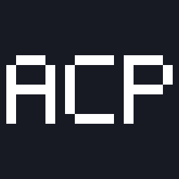
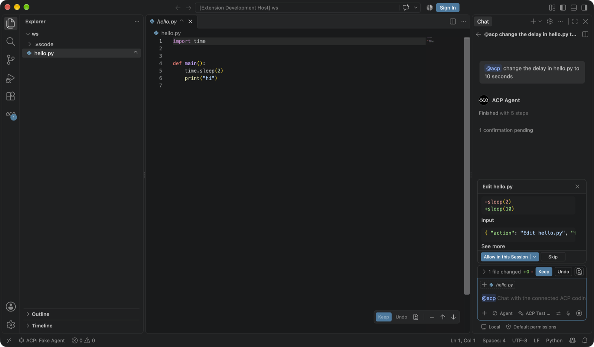
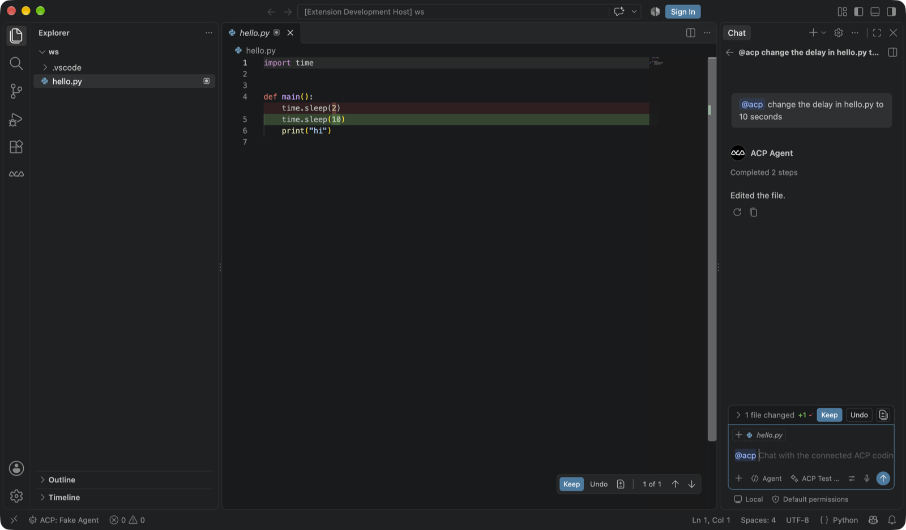
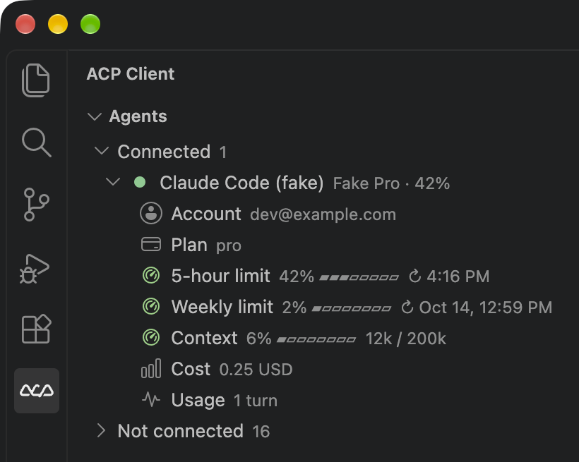

<div align="center">



# ACP Chat for VS Code

[](https://code.visualstudio.com/)
[](https://agentclientprotocol.com/)
[](LICENSE)

Run **Claude Code**, **Codex**, **Antigravity** or any other [Agent Client Protocol](https://agentclientprotocol.com/) coding agent inside VS Code's native Chat view, with Copilot-style edit review.

[Features](#features) • [Getting started](#getting-started) • [Usage](#usage) • [Configuration](#configuration) • [How it works](#how-it-works) • [Development](#development)

</div>

Each agent runs as its own official CLI, so you keep using your existing subscription or OAuth login for that vendor. The extension never handles vendor tokens itself.

> [!NOTE]
> Forked from [formulahendry/vscode-acp](https://github.com/formulahendry/vscode-acp) (ACP Client by Jun Han, MIT) and maintained by [aminballoon](https://github.com/aminballoon). It is built on VS Code's proposed chat APIs, so it is installed from a `.vsix`, not from the Marketplace.

## Features

<table>
<tr>
<td width="50%"><br><sub><b>Asks before editing</b>, with VS Code's own Allow / Skip UI and a preview of the change.</sub></td>
<td width="50%"><br><sub><b>Reviews edits like Copilot</b>: "files changed" bar, inline diff, Keep / Undo.</sub></td>
</tr>
</table>

- **Native "ACP" chat sessions.** Pickers under the input choose the agent, model, effort and mode. Each chat keeps its own picks, and several agents can run side by side.
- **Copilot-style edit review.** Agent edits become pending chat edits you Keep or Undo per file or per hunk, whether the agent writes through the client (`fs/write_text_file`) or on its own. Edits made outside edit tools (`sed -i`, the agent's own patch tooling) are found by snapshotting the workspace before and after the turn, in a private repository in the extension's storage. Your own git repository is never touched.
- **Native permission prompts.** ACP `session/request_permission` shows as a VS Code tool confirmation (Allow / Allow in this Session / Skip) with a diff preview.
- **Skills.** Pick one or more skills for the next prompt: the agent's own commands (`/review`, `/compact`, ...) or your own Markdown skills from `~/.acp/skills`, `.acp/skills` or any folder such as `~/.claude/skills`. Markdown skills work with every agent.
- **Persistent chats.** Chats survive restarts and reattach the agent's own session (`session/resume`, else `session/load`), so context is kept. Sessions the agent already has show up in the chat sessions list. Idle agents are disconnected to free memory and reconnect on the next message.
- **Agents view with usage limits.** See each connected agent's account, plan, five-hour and weekly limits with reset times, context window, cost and turns.
- **`@acp` participant** in any chat (e.g. Local), driving the agent's active session.
- **Fallback for agent-host sessions** (e.g. Copilot CLI), which reject extension edits: a diff card with Keep / Undo / Open diff, and a **Pending Changes** view that persists across restarts.
- **From the upstream ACP Client:** multi-agent configuration, terminal execution, protocol traffic logging and the agent registry.



<sub>Screenshots come from the automated UI test (`npm run test:ui`), which uses a fake agent and a placeholder model.</sub>

## Getting started

### Prerequisites

- **VS Code 1.140.x**
- **Node.js 18+**, available from a login shell (`/bin/zsh -l -c 'node -v'`). Agents are launched through your login shell.
- **The CLI of each agent you want to use**, already logged in:
  - Claude Code: `curl -fsSL https://claude.ai/install.sh | bash`, then run `claude` and `/login`
  - Codex: installed and logged in with `codex`
  - Antigravity: `agy` on your `PATH`

### Install

The installer works on macOS, Linux and Windows and needs VS Code's `code` command:

```bash
git clone https://github.com/aminballoon/vscode-acp.git
cd vscode-acp
npm run setup
```

`npm run setup` builds `acp-chat-<version>.vsix`, uninstalls the original **ACP Client** extension if present (both register the same commands), installs the `.vsix`, and adds `"enable-proposed-api": ["aminballoon.acp-chat"]` to `~/.vscode/argv.json` (keeping a backup as `argv.json.bak`).

> [!IMPORTANT]
> Quit VS Code completely (`Cmd+Q` / File → Exit) and open it again. `argv.json` is only read at startup.

| Option | Use |
|--------|-----|
| `npm run setup -- --vsix path/to/acp-chat.vsix` | Install a prebuilt `.vsix` (e.g. from GitHub Releases) without building |
| `npm run setup -- --insiders` | Target VS Code Insiders |
| `npm run setup -- --uninstall` | Remove the extension and its `argv.json` entry |

To update, run `git pull && npm run setup`, then **Developer: Reload Window**.

> [!TIP]
> Set `"update.mode": "manual"` in VS Code so an automatic update cannot break the proposed APIs before the extension is updated for them.

<details>
<summary>Manual installation</summary>

```bash
npm install
npx vsce package --no-dependencies
code --install-extension acp-chat-*.vsix
```

Then run **Preferences: Configure Runtime Arguments**, add this to `argv.json`, and restart VS Code:

```jsonc
"enable-proposed-api": ["aminballoon.acp-chat"]
```

</details>

## Usage

1. Click an agent in the **ACP** view, or run **Open ACP Chat** (`Cmd+Shift+A` / `Ctrl+Shift+A`). You can also pick **ACP** from the session type menu when starting a new chat.
2. Choose the model, effort and mode under the input, then type your request. The agent connects on first use.
3. Approve file edits and commands with **Allow**, or decline with **Skip**.
4. Review the changes in the "files changed" bar or the editor, then **Keep** or **Undo**.

To use skills, open the **Skills** picker under the input and choose **Choose Skills…**. The pick applies to the next prompt only. **New Skill…** creates a Markdown skill for every project or for this workspace; **Add Skill Files…** adds existing files or folders.

> [!TIP]
> Something wrong? **ACP: Show Log** and **ACP: Show Protocol Traffic** show what the agent sends. For a bug report, reproduce the problem and run **ACP: Export Debug Report**. File contents are logged only as a length and hash, protocol traffic is included only if you choose it, and agent `env` values are never included.

## Configuration

### Agents

| Agent | Command |
|-------|---------|
| Claude Code | `npx @agentclientprotocol/claude-agent-acp@latest` |
| Codex CLI | `npx @agentclientprotocol/codex-acp@latest` |
| Antigravity | `npx -y google-antigravity-acp` |

Add your own with **ACP: Add Agent Configuration** or the `acp.agents` setting.

### Settings

| Setting | Default | Description |
|---------|---------|-------------|
| `acp.agents` | *(see above)* | Agent configurations: each key is the agent name, with `command`, `args` and `env` |
| `acp.chat.nativeEdits` | `true` | Route agent edits into VS Code's native chat edit UI. Agent-host sessions fall back automatically |
| `acp.chat.idleDisconnectMinutes` | `15` | Disconnect an idle agent after this many minutes (`0` = never). Only agents that can restore sessions are disconnected |
| `acp.skills.paths` | `["~/.acp/skills", ".acp/skills"]` | Markdown skill files or folders offered to every agent. Relative paths resolve in each workspace folder |
| `acp.autoApprovePermissions` | `ask` | `ask` shows a confirmation; `allowAll` approves every request |
| `acp.defaultWorkingDirectory` | `""` | Working directory for agent sessions. Empty uses the current workspace |
| `acp.logTraffic` | `true` | Log all ACP traffic to the **ACP Traffic** output channel |

### Commands

| Command | Description |
|---------|-------------|
| **Open ACP Chat** (`Cmd+Shift+A` / `Ctrl+Shift+A`) | Open a new ACP chat |
| **ACP: Connect to Agent** / **Disconnect Agent** / **Restart Agent** | Manage the agent process |
| **ACP: Choose Skills for Next Prompt** / **New Skill** / **Add Skill Files or Folder** | Pick and manage skills |
| **ACP: Refresh Usage** | Re-read a connected agent's usage limits |
| **ACP: Keep All Changes** / **Undo All Changes** | Resolve everything in the Pending Changes view |
| **ACP: Add Agent Configuration** / **Remove Agent** | Edit `acp.agents` |
| **ACP: Show Log** / **Show Protocol Traffic** | Output channels for debugging |
| **ACP: Export Debug Report** | Save versions, settings and recent logs to one file |
| **ACP: Browse Agent Registry** | Discover ACP agents |

## How it works

```
VS Code Chat view ──@acp──▶ AcpChatParticipant ──session/prompt──▶ agent CLI (ACP over stdio)
        ▲                         │  ▲                                   │
        │ native parts            │  └── session/update (text, tools) ───┤
        │ (tool calls, edits,     ▼                                      │
        │  confirmations)     TurnRouter ◀── fs/write_text_file, ────────┘
        └──────────────────── PermissionTool    request_permission
```

| File | Role |
|------|------|
| [`src/chat/AcpChatSessions.ts`](src/chat/AcpChatSessions.ts) | The "ACP" chat session type: pickers, saved chats, per-chat agent sessions, skills and the agent's own sessions |
| [`src/chat/AcpChatParticipant.ts`](src/chat/AcpChatParticipant.ts) | Maps ACP session updates to chat parts; wraps edits by agents that write files themselves in `externalEdit` |
| [`src/chat/TurnRouter.ts`](src/chat/TurnRouter.ts) | Routes client-side ACP requests (file writes, permission prompts) to the streaming chat turn |
| [`src/chat/PermissionTool.ts`](src/chat/PermissionTool.ts) | Internal language-model tool that only shows VS Code's native confirmation UI |
| [`src/chat/proposed.ts`](src/chat/proposed.ts) | The only file that calls proposed APIs, with feature detection |
| [`src/ui/AgentTreeProvider.ts`](src/ui/AgentTreeProvider.ts), [`src/core/AgentStatus.ts`](src/core/AgentStatus.ts) | The Agents view and each agent's reported status and usage limits |
| [`src/changes/`](src/changes/) | Session-independent fallback: file snapshots, pending changes, the Pending Changes view, and `WorkspaceSnapshot.ts` for edits made outside edit tools |

> [!WARNING]
> If a VS Code update changes the proposed APIs, [`src/chat/proposed.ts`](src/chat/proposed.ts) is the file to fix.

## Development

```bash
npm install
npm run watch       # or: npm run compile
```

Press `F5` to start the Extension Development Host. `.vscode/launch.json` already passes `--enable-proposed-api`.

| Command | What it runs |
|---------|--------------|
| `npm test` | Unit tests: pending changes across turns, pre-edit content rebuilt from diffs, permission answers, skills, the debug report |
| `npm run test:e2e` | The `@acp` handler against a fake ACP agent (`test-fixtures/fake-agent.mjs`): approve, reject, keep and undo |
| `npm run test:ui` | macOS only. Drives the real Chat view and saves screenshots to `.vscode-test/screenshots/`. Needs Screen Recording permission for your terminal |
| `npm run test:codex` | Codex edit turns replayed by a fake Codex (`test-fixtures/fake-codex.mjs`, scenarios in `test-fixtures/codex-scenarios.json`), through the handler and the real Chat view |
| `npm run test:claude` | Claude-style edit turns (the fake agent) through the real Chat view |
| `npm run test:codex-live` | Real `@agentclientprotocol/codex-acp` with the Codex account on this machine. `ACP_CODEX_ACP` selects another build |
| `npm run test:claude-live` | Real `@agentclientprotocol/claude-agent-acp` with the Claude account on this machine. `ACP_CLAUDE_ACP` selects another build |

> [!CAUTION]
> The live suites spend a little of the logged-in account's quota.

The Chat view suites run each case as one chat, turn after turn, where the user keeps, undoes, edits the file themself or leaves changes pending. Each case runs with files closed and open, with prompts answered in the Chat view, and with diff cards instead of native edits. After every turn, each changed file must show a diff from its content when last kept or undone.

<details>
<summary>How the fake agents mimic real ones</summary>

The fake agent copies the message order Claude Code uses for edits: a `tool_call` with empty locations, locations in a later update, `request_permission`, the agent writing the file itself, then `completed`.

The fake Codex copies codex-acp: one `tool_call` already `in_progress` with a diff block per hunk (`_meta.kind` add, delete or update) and no locations, then `completed`. Codex writes files without waiting, before or while it reports them. To turn a Codex bug into a test, add a scenario to `codex-scenarios.json` (the **ACP Traffic** output channel shows what Codex sent).

`test-fixtures/fake-lm` registers a placeholder language model, because the Chat view refuses requests in a profile with no model.

</details>

## Known limitations

- Proposed APIs: install from `.vsix` only, and VS Code updates may need changes in `src/chat/proposed.ts`.
- The native confirmation shows an "Input" section with a short JSON summary of the action. VS Code offers no way to hide it for extension tools.
- Native Keep / Undo works only in **Local** chat sessions. Agent-host sessions (Copilot CLI and similar) get the fallback diff card.
- VS Code needs slash commands declared in advance, so only common ones are suggested; others still work when typed in full.
- Edits outside edit tools: binary files, files over 5 MB and files ignored by `.gitignore` are not shown. Deleted files and files with unsaved editor changes get the diff card instead of native Keep / Undo.
- "Allow in this Session" is remembered by VS Code, not passed to the agent as `allow_always`.

---

<div align="center">
<sub>Based on <a href="https://github.com/formulahendry/vscode-acp">ACP Client</a> by Jun Han. Bundled third-party licenses are listed in <a href="THIRD_PARTY_NOTICES.md">THIRD_PARTY_NOTICES.md</a>.</sub>
</div>
